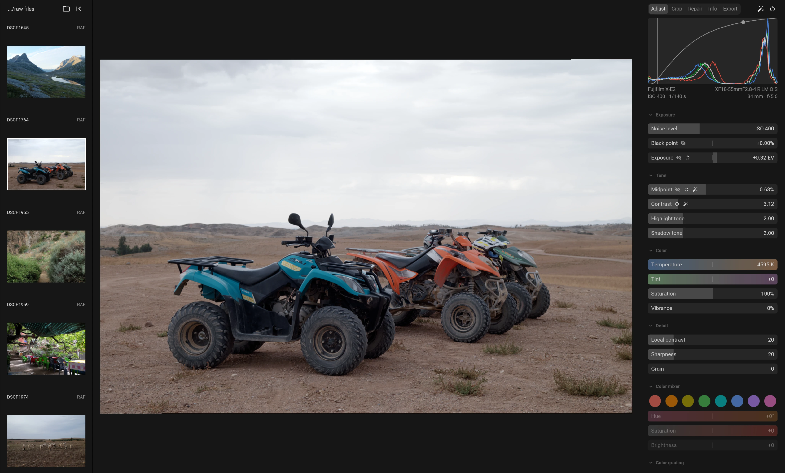

# Starfish 



Starfish is a basic raw photo editor for Linux, Windows and macOS. It is built on the [starfish-neural-demosaic](https://github.com/monkeypangit/starfish-neural-demosaic) project: the neural joint demosaicing and denoising networks come from there, and this app runs them on the GPU with wgpu. See that project for how the networks work, how they are trained, sample images and the background.

## Purpose
This project is intended to:

* Function as a basic raw editor
* Show the neural demosaicing and denoising in a real editing workflow
* Be a test bench for future demosaicing techniques
* Act as a way to connect with others interested in the topic

The basic architecture of the app is to do demosaicing + denoising first and store this in a texture on the GPU. All edits are then rendered in real time using the GPU on top of this texture when the preview is drawn in the UI. On export an off-screen texture matching the output resolution is created and the GPU renders the image to this texture using the same shader pipeline that renders the preview.

## System requirements
There is no CPU fallback in this app. You need a GPU that supports Vulkan (Linux, Windows), DirectX 12 (Windows) or Metal (macOS). 

| | Minimum | Recommended |
|---|---|---|
| OS | Windows 10, Linux with Vulkan drivers (Mesa 22+ or NVIDIA), macOS 12 | Windows 11, recent Mesa, macOS 13+ on Apple Silicon |
| GPU | Any Vulkan / DX12 / Metal GPU, 2 GB video memory | Discrete GPU or Apple Silicon with f16 shader support, 4–8 GB |
| RAM | 8 GB | 16 GB (32 GB for 60–100 MP files) |

Video memory use grows with resolution: about 1.5 GB for a 24 MP file, 3 GB at 45–61 MP and 5 GB or more at 100 MP. A 24 MP file takes about 0.5 s to demosaic on an RTX 5060 Ti and roughly 15 seconds on an integrate Vega 7 laptop iGPU. I would say something like an AMD Radeon 760M / Intel Iris Xe / Apple M1/M2 8-core GPU is the minimum system where this app can be used without being frustratingly slow in it's current form.

## Installing
Installers are currently generated automatically by GitHub. The Windows builds are not signed, so Windows will warn you the first time you run the installer.The app is currently waiting for approval from Microsoft.

| OS | File | First start |
|---|---|---|
| Windows | `starfish_<version>_x64-setup.exe` | SmartScreen says "Windows protected your PC": click **More info**, then **Run anyway**. |
| macOS | `starfish_<version>_aarch64.dmg` (Apple Silicon only) | Drag Starfish to Applications. The first time you open it, macOS asks whether to open an app downloaded from the internet: click **Open**. |
| Linux | `starfish_<version>_amd64.deb` or `starfish_<version>_x86_64.AppImage` | `.deb`: `sudo apt install ./starfish_<version>_amd64.deb`. AppImage: `chmod +x` it and run it. Both need Vulkan drivers. |

## Known issues
- The neural demosaic is not perfect; see the known issues of [starfish-neural-demosaic](https://github.com/monkeypangit/starfish-neural-demosaic).
- Dragging and dropping files into the editor and library should work on Windows and macOS. However on Linux under Wayland this is not implemented yet.

## Reporting problems
The app writes to a log file that is cleared each time the app starts. You can find it here:

| OS | Log file |
|---|---|
| Linux | `~/.local/state/starfish/starfish.log` |
| Windows | `%LOCALAPPDATA%\Starfish\starfish.log` |
| macOS | `~/Library/Logs/Starfish/starfish.log` |

If you run into a technical issue that you want to report, please check if there are any error messages at the bottom of this file and include them in your issue. There is information about what GPU you are running in the metadata tab in the UI. Please include this information along with the camera model metadata field.

## Contributing
Please feel free to reach out or contribute to the project if you are interested. I only request that contributions are somewhat in line with the intent of the project :) Training and model questions belong in [starfish-neural-demosaic](https://github.com/monkeypangit/starfish-neural-demosaic).

## Other dependencies
Raw files are decoded with [rawler](https://github.com/dnglab/dnglab). Without it and the many other dependencies this project would not have been possible. Please inspect the rust manifest file in the project root folder for details.

## Building
_AI generated_

You need a stable Rust toolchain. On Linux, also install the `libxkbcommon` and `wayland` development packages.

```
cargo build --release
./target/release/starfish
```

Release builds embed the neural networks (about 8 MB). Debug builds read them from `models/*_wgpu/` at run time instead. The exports are produced by [starfish-neural-demosaic](https://github.com/monkeypangit/starfish-neural-demosaic) and copied into `models/` with `scripts/sync-models.sh`.

To build the installers yourself, install `cargo install --locked cargo-packager` and `cargo install --locked cargo-about --features cli`, then run `cargo packager --release`. The packages are written to `dist/`.

Each OS can only package its own formats, and a Linux build only runs on systems with at least the glibc version it was built against. That's why the published packages come from CI on Ubuntu 22.04.

Some environment variables help with debugging. `WGPU_BACKEND=vulkan|dx12|metal|gl` picks the graphics API, and `STARFISH_DEMOSAIC=binning` replaces the neural stage with a simple, fast demosaic.

## License

Starfish's code is dual-licensed under either of

- Apache License, Version 2.0 ([LICENSE-APACHE](LICENSE-APACHE))
- MIT license ([LICENSE-MIT](LICENSE-MIT))

at your option. Unless you explicitly state otherwise, any contribution you intentionally submit for inclusion in the work shall be dual-licensed as above, without any additional terms or conditions.

Third-party parts:

- **rawler** is licensed under the **LGPL-2.1** and is linked statically. Its source is at <https://github.com/dnglab/dnglab>. You can rebuild Starfish with a modified rawler by changing the dependency in `Cargo.toml`.
- **Fonts:** Roboto and Material Icons are under the Apache License 2.0, and Roboto Mono is under the SIL Open Font License 1.1. Their licences are in `resources/`.
- **Model weights** (`models/*_wgpu/`) come from [starfish-neural-demosaic](https://github.com/monkeypangit/starfish-neural-demosaic) and were trained on the DIV2K dataset, which is provided for academic research. Its terms may apply to these weights. They will be replaced by weights trained on contributed data.
