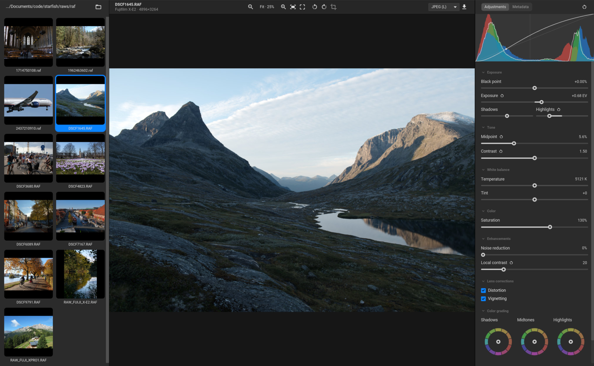
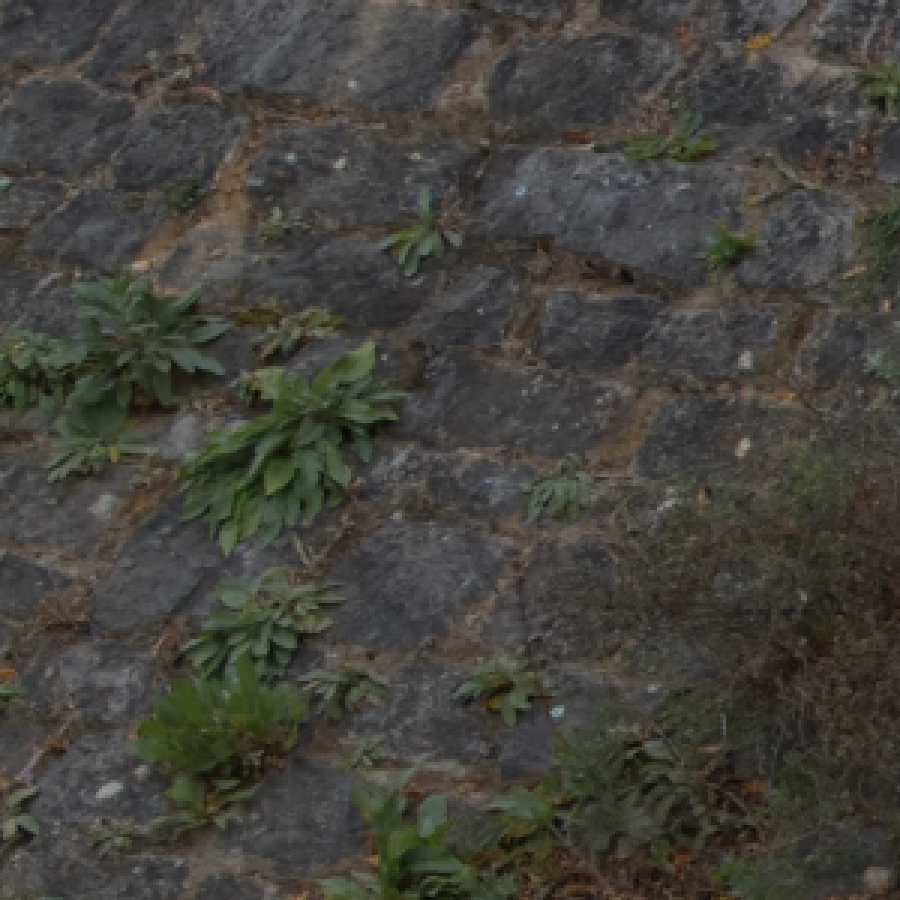
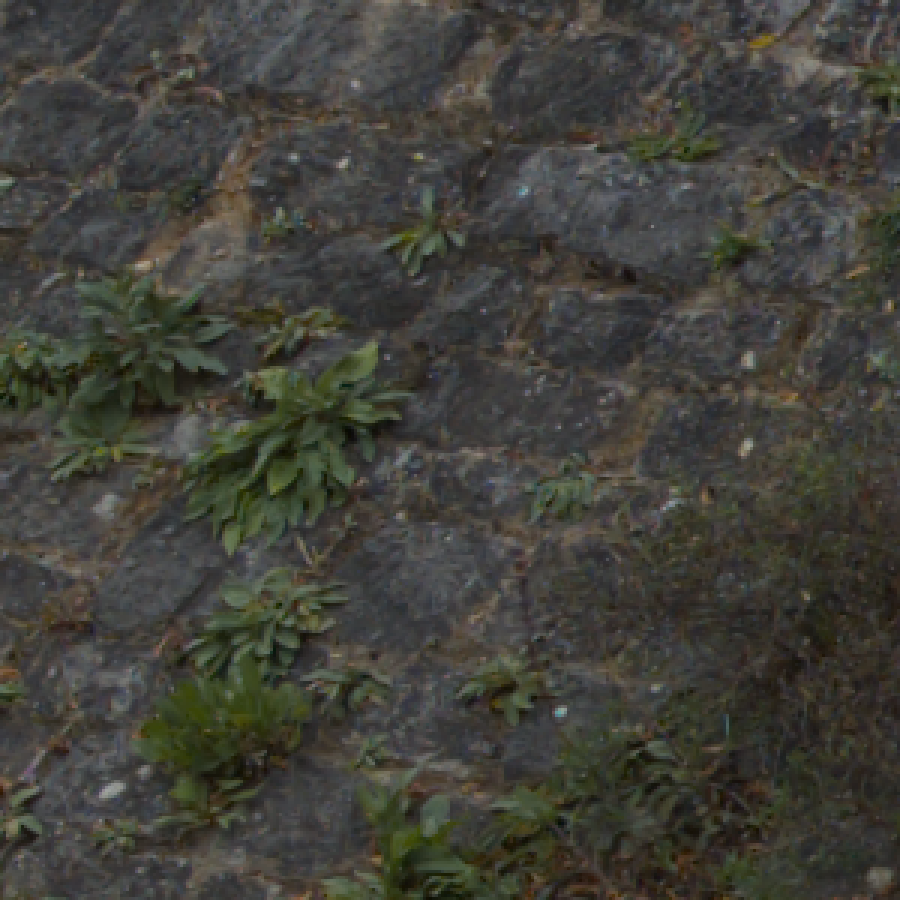
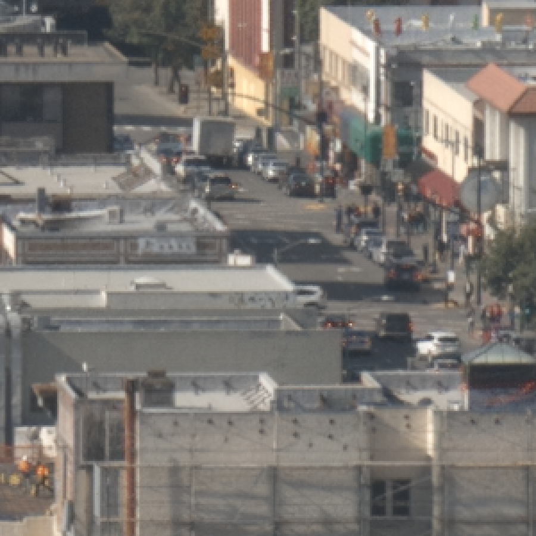
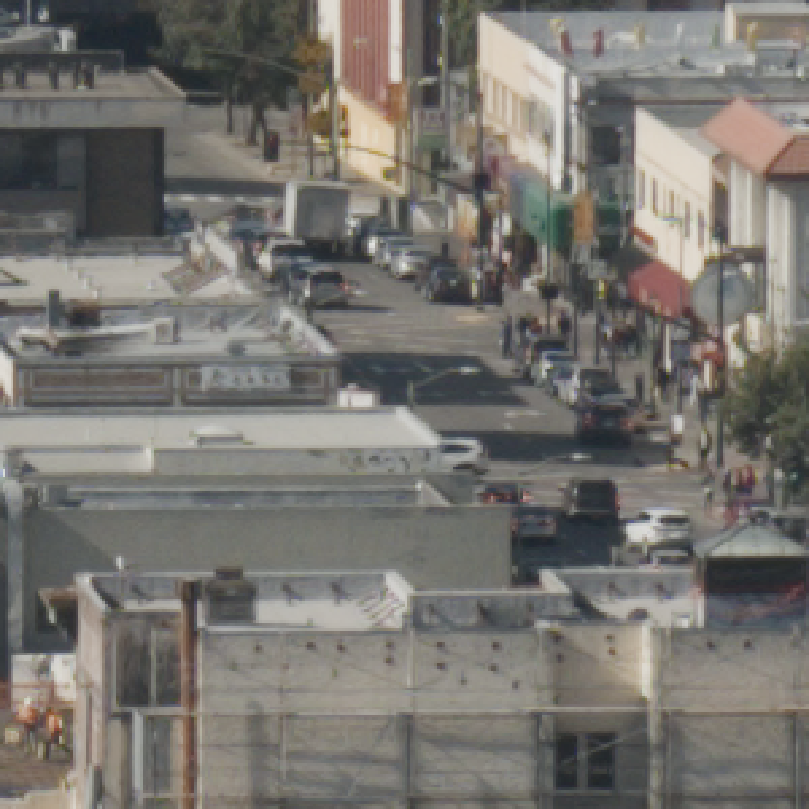

# Starfish 



## Purpose
This project is intended to:

* Function as a basic raw editor
* Show the output quality of a basic neural joint demosaicing and denoising model
* Illustrate the viability of using wgpu as a distribution platform for neurual models in raw photo editors
* Be a test bench for future demosaicing techniques
* Act as a way to connect with others interested in the topic

Ultimately the idea is to develop a solid pipeline for joint demosaicing + denoising + chromatic aberration correction that can be integrated into other projects. This would avoid the need to maintain this application as a separate project.

The basic architecture of the app is to do demosaicing + denoising first and store this in a texture on the GPU. All edits are then rendered in real time using the GPU on top of this texture when the preview is drawn in the UI. On export an off-screen texture matching the output resolution is created and the GPU renders the image to this texture using the same shader pipeline that renders the preview.

## The demosaicing pipeline
The demosaicing is currently based on the [Deep Joint Demosaicking and Denoising by Gharbi et al. (2016)](https://groups.csail.mit.edu/graphics/demosaicnet/) paper and reference code. This project currently uses a slightly scaled down version of that model.

It differs from the DemosaicNet implementation in that it uses per CFA site filter banks in the full resolution output stage of the model. This allows the X-Trans version of the model to use the same packed trunk architecture as the Bayer version (packed as 6x6 instead 2x2). Also instead of doing 3x3 convolutions throughout the trunk the X-Trans model uses alternating 3x3 and 1x1 convolutions in an attempt to match the total receptive field and overall computational complexity of the Bayer version. The paper uses full scale trunk for X-Trans demosacing.

My understanding is that the DemosaicNet paper included the X-Trans model to show that their ideas generalized to other CFA layouts beyond Bayer. The X-Trans model was never intended to be optimal.

None of my changes have been proven to be better or preferable to the architecture used in the paper. My focus has been on making both models fit a common architectural pipeline and to match a certain performance target. The idea was to reach a performance target of 1-2 seconds to demosaic a 24 megapixel image on a 20-series Nvidia GPU, 2-5 seconds on modern iGPUs and 5-20 seconds on older iGPUs.

## System requirements
There is no CPU fallback in this app. You need a GPU that supports Vulkan (Linux, Windows), DirectX 12 (Windows) or Metal (macOS). 

| | Minimum | Recommended |
|---|---|---|
| OS | Windows 10, Linux with Vulkan drivers (Mesa 22+ or NVIDIA), macOS 12 | Windows 11, recent Mesa, macOS 13+ on Apple Silicon |
| GPU | Any Vulkan / DX12 / Metal GPU, 2 GB video memory | Discrete GPU or Apple Silicon with f16 shader support, 4–8 GB |
| RAM | 8 GB | 16 GB (32 GB for 60–100 MP files) |

Video memory use grows with resolution: about 1.5 GB for a 24 MP file, 3 GB at 45–61 MP and 5 GB or more at 100 MP. A 24 MP file takes about 0.5 s to demosaic on an RTX 5060 Ti and roughly 15 seconds on an integrate Vega 7 laptop iGPU. I would say something like an AMD Radeon 760M / Intel Iris Xe / Apple M1/M2 8-core GPU is the minimum system where this app can be used without being frustratingly slow in it's current form.

## Installing
Installers are currently generated automatically by GitHub. The Windows builds are not signed, so Windows will warn you the first time you run the installer.The app is currently waiting for approval from Microsoft.

| OS | File | First start |
|---|---|---|
| Windows | `starfish_<version>_x64-setup.exe` | SmartScreen says "Windows protected your PC": click **More info**, then **Run anyway**. |
| macOS | `starfish_<version>_aarch64.dmg` (Apple Silicon only) | Drag Starfish to Applications. The first time you open it, macOS asks whether to open an app downloaded from the internet: click **Open**. |
| Linux | `starfish_<version>_amd64.deb` or `starfish_<version>_x86_64.AppImage` | `.deb`: `sudo apt install ./starfish_<version>_amd64.deb`. AppImage: `chmod +x` it and run it. Both need Vulkan drivers. |

## Known issues
- The neural demosaic is not perfect. There is luma zippering in overexposed saturated areas. The X-Trans model is prone to zippering along sharp edges. The Bayer model struggles with moiré patterns.
- Dragging and dropping files into the editor and library should work on Windows and macOS. However on Linux under Wayland this is not implemented yet.

## Future improvements
The most important issue is to push up performance and output quality of the neural demosaicing. The Bayer output is currently looking quite good. Some moire remains but otherwise ok. X-Trans model shows luma zippering along edges. I am uncertain exactly why this happens but adding more layers to the full resolution head of the model and/or increasing the number of channels into the head layers help but makes the model slower.

- Better faster demosaicing + denoising (different CNN architecture?)
- Custom library of RAW files for model training collected from contributors or online sources of raw images with appropriate license.
- Chromatic aberration correction properly integrated into the demosaicing + denoising stage.

## Reporting problems
The app writes to a log file that is cleared each time the app starts. You can find it here:

| OS | Log file |
|---|---|
| Linux | `~/.local/state/starfish/starfish.log` |
| Windows | `%LOCALAPPDATA%\Starfish\starfish.log` |
| macOS | `~/Library/Logs/Starfish/starfish.log` |

If you run into a technical issue that you want to report, please check if there are any error messages at the bottom of this file and include them in your issue. There is information about what GPU you are running in the metadata tab in the UI. Please include this information along with the camera model metadata field.

<br>

# Background
I created this project after spending a little over a year researching hand crafted demosaicing methods such as RCD (for the Bayer CFA pattern) and Markesteijn (for the Fujifilm X-Trans CFA pattern). These are the methods traditionally used in open source raw image editors.

Methods like RCD, Markesteijn and others were created by very dedicated and academically skilled individuals. They are highly principled and produce great results for what they are. However, they were created in a time where computational resources were scarce and the cross platform support for GPU acceleration was not at the place it is today.

Initially I attempted to improve these traditional hand crafted methods. I had some success, but not to the point where I was happy with the output. The X-Trans CFA is an especially difficult case. Ultimately I decided to try nerual demosaicing. I found [Deep Joint Demosaicking and Denoising by Gharbi et al. (2016)](https://groups.csail.mit.edu/graphics/demosaicnet/) and I was blown away by the results. I had completely underestimated how much better these methods were in terms of output quality.

There are ways to improve the output quality of traditional methods like RCD and Markesteijn. Part of this project also includes writing a practical guide to demosaicing for people who are interested in the topic. The literature is dense and the sheer volume of published papers on the topic makes it difficult to approach.

Arguably we are currently in the period where hybrid hand crafted + nerual methods will serve most user the best from a quality/performance standpoint. However, I have not been able to find any such methods that seem mature enough to be implementable as is. So any such approach would include considerable effort in terms of innovation.

## Sample images
Here are some test images to show what the output looks like. The difference is difficult make out against the white page background. I also tried to pick fair comparisons to not oversell the difference. The images are sourced from [PIXLS.us](https://raw.pixls.us/). It was hard to find good images with a permissive license to illustrate the difference. You might want to download the full size images and pixel peep to really get an idea.

The differences are most easily spotted in high contrast areas such as dark tree leaves  against a bright sky, ripples on a water surface, bright objects against a dark background etc. It also shows in on smooth lightly textured regions such as the facade of a building or on rocks and pebbles. In such areas it shows up as subtle blotchy shifts in hue. Noisy regions also show a difference where the the grain becomes discolored and blotchy with many traditional methods.

You may want to download the full scale images and compare while zoomed in for a better view.

| | Starfish neural demosaic | Traditional hand crafted demosaic |
|---|---|---|
| Bayer |  |  |
| | [Full image](resources/samples/bayer_starfish.png) | [Full image](resources/samples/byer_hand_crafted.png) |
| X-Trans |  |  |
| | [Full image](resources/samples/xtrans_starfish.png) | [Full image](resources/samples/xtrans_hand_crafted.png)

Also, please note that the neural demosaicing in this project is not without flaws. Most noticeably it suffers from luma zippering in both the Bayer and X-Trans model in high contrast and overexposed saturated areas. Hopefully this can be fixed with better training data sets or alterations to the model architecture.

## Wgpu as a distribution platform
This project also aims to show the viability of using wgpu/WebGPU as a relatively hassle free way to run neural models on a variety of hardware. This project uses Rust ([iced](https://iced.rs) + [wgpu](https://wgpu.rs)). Iced is a cross platform UI library that uses wgpu for drawing the user interface. Wgpu is a cross platform Rust graphics API based on the WebGPU API. WebGPU in turn is a standardized API for interfacing with GPUs.

Wgpu wraps several platform specific libraries such as DirectX, Metal and Vulkan such that you can write the shader code once an run it on any system with minimal risk of technical issues. There are more purposeful alternatives such as [onnx](https://github.com/onnx/onnx). The alternatives can be more performant, but they can also be more complex to set up for the end user.

Ultimately it is hard to say what is the best setup. These things are still under active development and drivers and operating systems improve constantly. This project explores one possible path using Pytorch for training and wgpu sharers for deployment.

## Other dependencies
Raw files are decoded with [rawler](https://github.com/dnglab/dnglab). Without it and the many other dependencies this project would not have been possible. Please inspect the rust manifest file in the project root folder for details.

## Training models

Training a model takes ~1 hour on my Nvidia RTX 5060 Ti 16GB. You can also use online serverless GPU services such as Modal as an alternative to running locally. You can read the AI summary below for technical details on how to perform the training.

The traning stage takes an image library such as the DIV2K and turns them into a large GPU buffer. During training the GPU draws random patches from this buffer, transforms them into linear camera space and applies random variations to them such as exposure compensation, flipping them, adding noise etc. This is intended to give the model under training the most varied set of data possible.

Initially I used hard patch mining similar to the DemosaicNet paper. The paper pre-processes the training images to find image patches with high frequency details. However, I opted out of this towards the end to simplify the training pipeline. It is convenient to create random patches from the test images on the fly. Maybe there is a way to identify hard patches during training and re-use them multiple times. However when adding noise to the training patches this will dominate what patches qualify as difficult rather than the contents of the original image.

## Contributing
Please feel free to reach out or contribute to the project if you are interested. I only request that contributions are somewhat in line with the intent of the project :)

## Building
_AI generated_

You need a stable Rust toolchain. On Linux, also install the `libxkbcommon` and `wayland` development packages.

```
cargo build --release
./target/release/starfish
```

Release builds embed the neural networks (about 8 MB). Debug builds read them from `training/*_wgpu/` at run time instead.

To build the installers yourself, install `cargo install --locked cargo-packager` and `cargo install --locked cargo-about --features cli`, then run `cargo packager --release`. The packages are written to `dist/`.

Each OS can only package its own formats, and a Linux build only runs on systems with at least the glibc version it was built against. That's why the published packages come from CI on Ubuntu 22.04.

Some environment variables help with debugging. `WGPU_BACKEND=vulkan|dx12|metal|gl` picks the graphics API, and `STARFISH_DEMOSAIC=binning` replaces the neural stage with a simple, fast demosaic.

## Training
_AI generated_

`training/` holds the PyTorch code that trains the demosaic networks and compiles them to WGSL shaders. `wgpu-run/` is the model-agnostic GPU runner, with a command-line test and benchmark tool. See [AGENTS.md](AGENTS.md) for the details and commands.

Training needs the DIV2K training images in `training/data/DIV2K_train_HR/`, which you add yourself; [training/data/README.md](training/data/README.md) says where to get them and how to prepare them.

The bundled networks were trained on [DIV2K](https://data.vision.ee.ethz.ch/cvl/DIV2K/): 8-bit sRGB images converted to linear light, with a simulated sensor. They are meant to be replaced by networks trained on real raw files with higher bit depth in the future.

## License

Starfish's code is dual-licensed under either of

- Apache License, Version 2.0 ([LICENSE-APACHE](LICENSE-APACHE))
- MIT license ([LICENSE-MIT](LICENSE-MIT))

at your option. Unless you explicitly state otherwise, any contribution you intentionally submit for inclusion in the work shall be dual-licensed as above, without any additional terms or conditions.

Third-party parts:

- **rawler** is licensed under the **LGPL-2.1** and is linked statically. Its source is at <https://github.com/dnglab/dnglab>. You can rebuild Starfish with a modified rawler by changing the dependency in `Cargo.toml`.
- **Fonts:** Roboto and Material Icons are under the Apache License 2.0, and Roboto Mono is under the SIL Open Font License 1.1. Their licences are in `resources/`.
- **Model weights** (`training/*.pt`, `training/*_wgpu/`) were trained on the DIV2K dataset, which is provided for academic research. Its terms may apply to these weights. They will be replaced by weights trained on contributed data.
